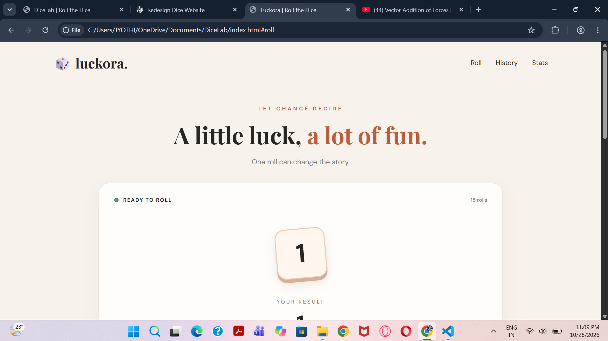

# Luckora 🎲

A simple dice roller website built using HTML, CSS, and JavaScript.

Luckora lets you roll one or two dice, check your results, and keep track of your previous rolls. I built this project while learning frontend development and practicing JavaScript.

## Screenshot



## Features

- Roll one or two six-sided dice
- Simple dice-rolling animation
- Display the total after each roll
- Track total rolls, average score, and highest score
- View the 10 most recent rolls
- Clear roll history
- Responsive design for mobile and desktop

## Tech Stack

- **HTML** - Website structure
- **CSS** - Styling and animations
- **JavaScript** - Dice logic and interactivity

## How to Run

1. Clone this repository:

   ```bash
   git clone https://github.com/YOUR_USERNAME/luckora.git
   ```

2. Open the project folder:

   ```bash
   cd luckora
   ```

3. Open `index.html` in your browser.

No additional installations are required.

## Project Structure

```text
luckora/
├── index.html
├── style.css
├── script.js
├── README.md
└── screenshots/
    └── homepage.png
```

## What I Learned

While building this project, I got to practice:

- DOM manipulation
- JavaScript functions and event listeners
- Working with arrays
- Generating random numbers
- CSS animations
- Responsive web design

## Future Improvements

Some features I might add later:

- Different dice styles
- Light and dark mode
- Saving roll history between sessions

## Author

Built as a personal frontend development project.
